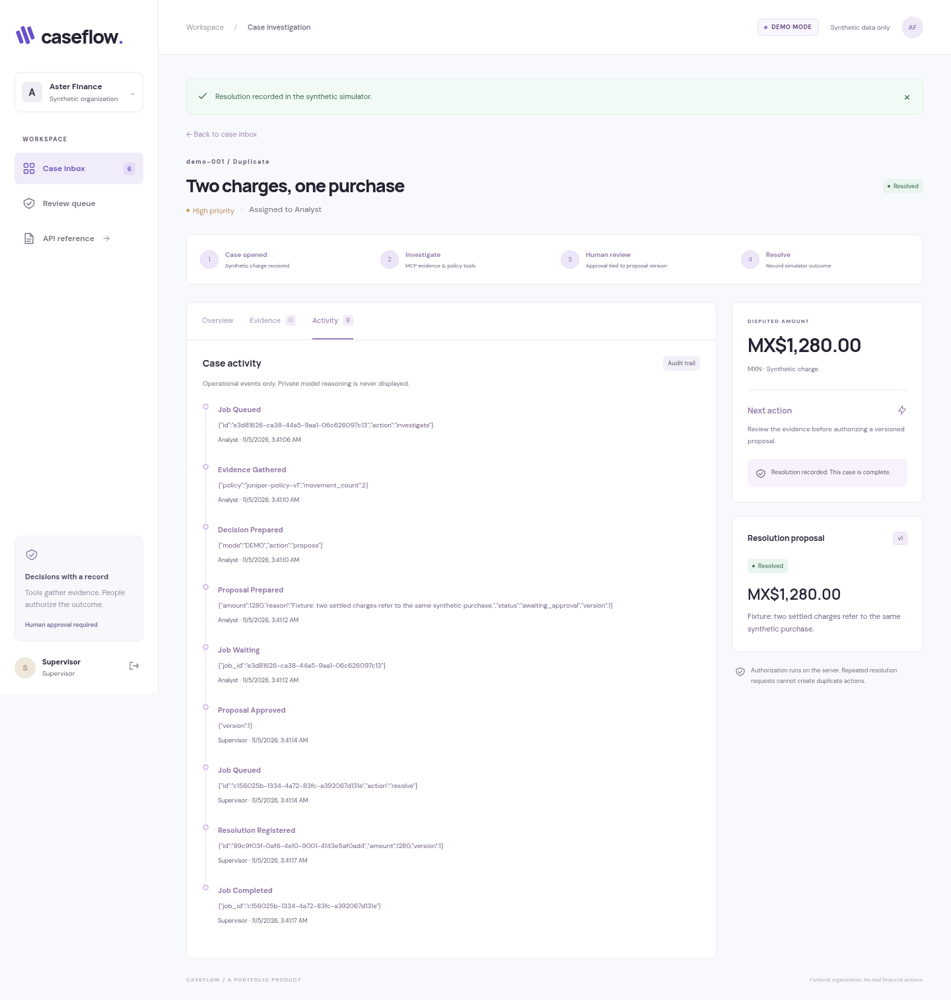

# Caseflow Agent

A working investigation desk for **fictional charges**, built with Next.js, FastAPI, PostgreSQL, LangGraph and an actual MCP client/server. No real financial operations, regulatory compliance claims or customer data.

**DEMO starts without keys:**

```sh
docker compose up --build -d
```

A verified alternative runs the application processes on the host and PostgreSQL in Docker:

```sh
./scripts/demo-local.sh
```

This requires Python 3.12, uv, Node 24 and Docker; it installs locked dependencies if missing, builds Next, starts API/worker/web, and stops app processes on Ctrl+C while preserving the database. The prior registry HTTP 503 was rechecked during the audit: an uncached build and fresh isolated four-service Compose startup now pass. See [current audit evidence](docs/audit.md); the launcher remains an explicit host-runtime alternative, not Docker-build evidence.

Open **http://localhost:3102**. Sign in as `analyst` or `supervisor`, password `demo-pass`. These are explicitly public local simulator accounts. PostgreSQL persists data in a Docker volume; application and API share one browser origin. API documentation is at `/api/docs` (proxied OpenAPI UI).

DEMO replaces only model decisions with labelled scenario fixtures. Tool calls, authorization, proposals, exact-version approvals, checkpoints, audit events and simulator resolutions execute for real. LIVE never falls back to DEMO.



## Two-minute demonstration

1. Sign in as analyst; select **Two charges, one purchase** and investigate. The worker retrieves movements and policy through MCP and creates proposal version 1.
2. Inspect movements, user-facing explanation and the event timeline. No private model reasoning is shown.
3. Switch to supervisor, approve version 1 and request resolution. The workflow resumes its PostgreSQL checkpoint and records one simulator resolution.
4. Try **Merchant feed unavailable**, then resume after its fixture outage. Try **Interrupted investigation** to resume an explicit persisted interrupt.
5. **Missing delivery evidence** records an evidence request. **Purchase confirmed by customer** recommends rejection, which requires a supervisor.

To repeat the walkthrough intentionally, run `PYTHONPATH=services/api uv run python scripts/reset_demo.py --confirm-synthetic-data` when no jobs are active. This resets only the five shipped DEMO cases and their checkpoints; startup never resets data automatically.

Editing a proposal invalidates approval. Reimbursements cannot exceed the disputed amount. Row locks and a unique resolution constraint prevent concurrent retries from duplicating the action. These controls establish authorization properties, **not model immunity to prompt injection**.

## Audit and reproducibility

[The technical audit](docs/audit.md) records the initial commit, defects, transaction/lease corrections, exact commands, fresh Compose project, provider contracts and limits. Do not infer model quality from software test counts. The isolated audit uses ports 3202/8202/5642 and a new volume, preserving the ordinary demo.

## Developer commands

Validated with Python 3.12, uv 0.13.4, Node 24.22.1 and Docker Compose 2.40.3. The audit override uses Compose 2.24.4+ port replacement. Exact direct pins and transitive lockfiles are committed.

```sh
docker compose up -d db
uv sync --frozen
docker compose exec -T db createdb -U caseflow caseflow_test  # once
uv run pytest -q
uv run ruff check services tests scripts
uv run python -m compileall -q services scripts
cd apps/web
npm ci
npm run lint
npm run typecheck
npm test
npm run build
npm run test:e2e  # against a running DEMO stack; see docs/testing.md
```

Host development: `PYTHONPATH=services/api uv run uvicorn caseflow.main:app --port 8102` and `PYTHONPATH=services/api uv run python -m caseflow.worker`; in `apps/web`, `API_INTERNAL_URL=http://localhost:8102 npm run dev -- --port 3102`. API and worker run the same idempotent SQL migration and seed under PostgreSQL advisory locks.

## LIVE

See [exact activation and verification](docs/live.md). OpenAI and Gemini official SDK adapters validate structured output, bound concurrent requests, set timeouts and apply bounded retries. Terminal truncation, refusal and safety blocks are rejected even if their text looks like valid JSON. They are tested through mocked HTTP transports. **No external model call has been verified in this delivery.** The model proposes a typed decision; server-side tools authorize actual effects. The simulator remains synthetic even in LIVE.

## Engineering review

- [Architecture and decisions](docs/architecture.md)
- [Security and operating model](docs/operations.md)
- [Testing evidence and limits](docs/testing.md)
- [Azure deployment configuration](infra/README.md) — configuration, not a deployed service
- [Guía en español](docs/GUIA_ES.md)
- [Progress log](docs/progress.md)

The product is intentionally a compact portfolio system: one API, one durable worker and MCP child processes. No external merchant integration, real reimbursements, SSO, multitenant customer administration or model quality claims are implied.
