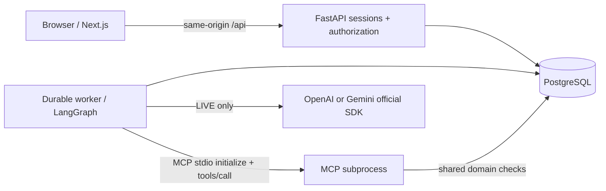
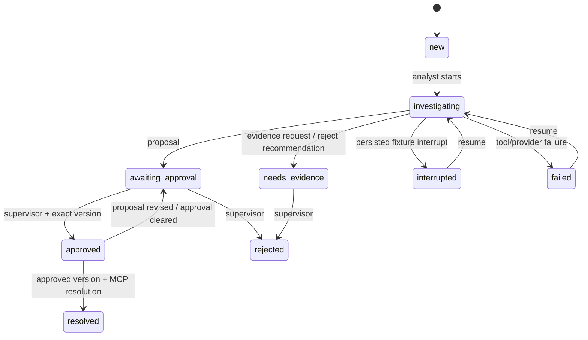

# Architecture and decisions

**ADR 1 — one deployment origin.** Next forwards `/api/*` to FastAPI. Session cookies are HttpOnly, SameSite Strict, and Secure in HTTPS environments. The origin and fetch-site checks reject cross-site writes. Mutations require JSON. Authorization occurs in the domain and API, not UI controls.

**ADR 2 — stdio MCP.** Each capability invocation launches the actual SDK server as a separate child process and performs MCP initialization and tools/call over stdio. There is no network listener, token endpoint, remote MCP connection or HTTP transport; HTTP Origin/OAuth requirements do not apply to this local transport. Stdout is reserved for the protocol; logs go to stderr. The parent binds actor, case ID, correlation and active job/attempt capability in a minimal environment. Neither model output nor HTTP payload selects executable paths, roles or credentials. Provider keys are not passed to the MCP child. The tool allowlist is fixed, schema arguments are validated, requests time out after 25 seconds, and subprocess lifetime follows the client context.

**ADR 3 — durable execution.** Jobs use `FOR UPDATE SKIP LOCKED`, 60-second leases and 1-second renewal. PostgreSQL LangGraph checkpoints use a separate mode-qualified thread per case. Explicit interrupts persist approval and interruption boundaries. Restart opens a new graph against those same checkpoints; expired running jobs are reclaimed. MCP proposals use persistent idempotency receipts and evidence requests deduplicate their stable per-case request ID; resolution has a unique case constraint and transactional row lock. The worker recursion limit is 12 and each process handles one job at a time. Timeline events may repeat if a read-only graph node replays after a crash; financial simulator side effects remain idempotent.

**ADR 4 — bounded agent.** LIVE makes a validated `Decision` (propose/request evidence/recommend rejection) through structured SDK output, then uses a fixed state graph to invoke tools. It does not allow arbitrary model-generated function names. Tool decisions and effects use the same graph in DEMO. Five DEMO scenario IDs map explicitly to fixtures; arbitrary natural-language interpretation is not simulated. Freeform conversations are not an advertised capability; the case conversation records safe public explanations.

**ADR 5 — mode separation.** Cases, accounts and sessions carry `DEMO` or `LIVE`; queries filter the active mode. Checkpoint threads include mode. DEMO users are not provisioned in LIVE. Both modes use original synthetic simulator charges; LIVE changes model inference, not the external systems available to the agent.

**ADR 6 — lease fencing and checkpoint serialization (audit correction).** An incrementing job attempt is a fencing token checked with status and lease expiry in each effect transaction. A `ContextVar` propagates it through graph tasks; the trusted MCP launcher transfers it through its environment. This avoids treating an old worker as authorized simply because its process survived a lease expiry. A per-case PostgreSQL **session advisory lock** separately serializes graph checkpoint writers. It is held on a dedicated connection, not on the case row, so MCP child transactions do not deadlock. Cancellation fences effects immediately; in-flight task cancellation follows the one-second heartbeat. Reset tooling obtains the same advisory lock before deleting demo checkpoints. Cancellation/failure preserves a valid proposal/approval as a reviewable state. The total invocation deadline is configurable (180 seconds by default).

## State transitions

## Version sources consulted

Consulted official documentation on 2026-11-05: [LangGraph persistence](https://docs.langchain.com/oss/python/langgraph/persistence), [MCP server guide](https://modelcontextprotocol.io/docs/develop/build-server), [OpenAI SDKs](https://platform.openai.com/docs/libraries), [Gemini quickstart](https://ai.google.dev/gemini-api/docs/quickstart), [Next.js installation](https://nextjs.org/docs/app/getting-started/installation). Python direct versions are pinned to stable compatible APIs (MCP 1.x stdio and LangGraph 1.x persistence); uv.lock fixes transitive versions. Next/React exact stable versions are pinned in package-lock.json. Provider/model strings remain configurable; structured-output support must exist for the selected model. SDK parity is not assumed: OpenAI uses JSON Schema response format, Gemini its generation response schema. No model token usage or latency is synthesized.
